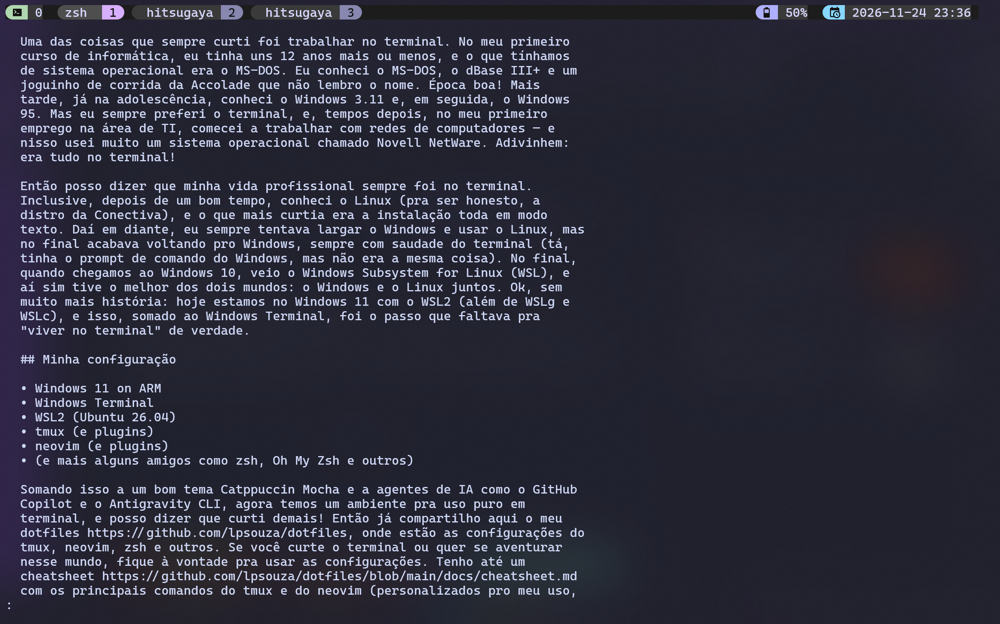

Uma das coisas que sempre curti foi trabalhar no terminal. No meu primeiro curso de informática, eu tinha uns 12 anos mais ou menos, e o que tínhamos de sistema operacional era o MS-DOS. Eu conheci o MS-DOS, o dBase III+ e um joguinho de corrida da Accolade que não lembro o nome. Época boa! Mais tarde, já na adolescência, conheci o Windows 3.11 e, em seguida, o Windows 95. Mas eu sempre preferi o terminal, e, tempos depois, no meu primeiro emprego na área de TI, comecei a trabalhar com redes de computadores — e nisso usei muito um sistema operacional chamado Novell NetWare. Adivinhem: era tudo no terminal!

Então posso dizer que minha vida profissional sempre foi no terminal. Inclusive, depois de um bom tempo, conheci o Linux (pra ser honesto, a distro da Conectiva), e o que mais curtia era a instalação toda em modo texto. Daí em diante, eu sempre tentava largar o Windows e usar o Linux, mas no final acabava voltando pro Windows, sempre com saudade do terminal (tá, tinha o prompt de comando do Windows, mas não era a mesma coisa). No final, quando chegamos ao Windows 10, veio o Windows Subsystem for Linux (WSL), e aí sim tive o melhor dos dois mundos: o Windows e o Linux juntos. Ok, sem muito mais história: hoje estamos no Windows 11 com o WSL2 (além de WSLg e WSLc), e isso, somado ao Windows Terminal, foi o passo que faltava pra "viver no terminal" de verdade.

## Minha configuração

- Windows 11 on ARM
- Windows Terminal
- WSL2 (Ubuntu 26.04)
- tmux (e plugins)
- neovim (e plugins)
- (e mais alguns amigos como zsh, Oh My Zsh e outros)

Somando isso a um bom tema Catppuccin Mocha e a agentes de IA como o GitHub Copilot e o Antigravity CLI, agora temos um ambiente pra uso puro em terminal, e posso dizer que curti demais! Então já compartilho aqui o meu [dotfiles](https://github.com/lpsouza/dotfiles), onde estão as configurações do tmux, neovim, zsh e outros. Se você curte o terminal ou quer se aventurar nesse mundo, fique à vontade pra usar as configurações. Tenho até um [cheatsheet](https://github.com/lpsouza/dotfiles/blob/main/docs/cheatsheet.md) com os principais comandos do tmux e do neovim (personalizados pro meu uso, espero que gostem).

E, como diria o Gaguinho: "Isso é tudo, pessoal!" 😎
